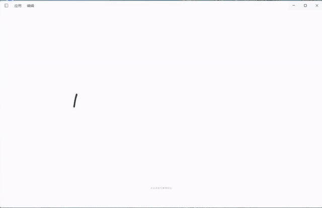
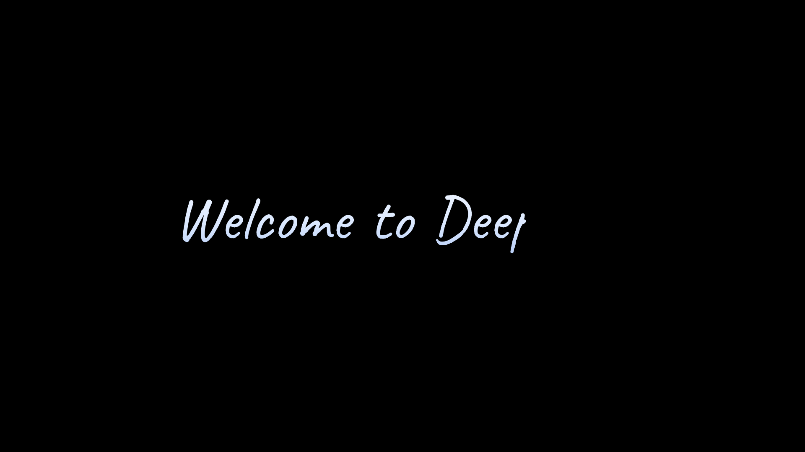
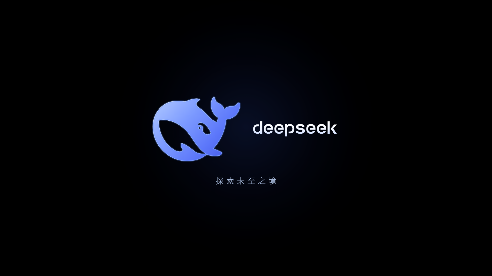
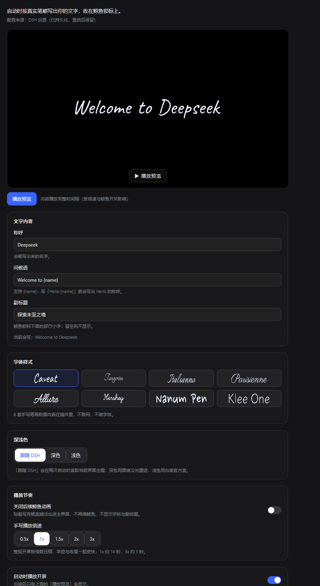

# 演示

[▶ 高清 MP4（1280×826，620 KB）](https://github.com/w-j-y-wjy/dsh-ink-whale/blob/main/assets/demo.mp4) · 浅色主题，15 秒完整流程

为什么这里放 GIF 而不是 `<video>`：GitHub 的 Markdown 会过滤掉 `<video>` 标签，只有在网页编辑器里直接拖入的视频才会变成播放器（`user-attachments` 链接，无法用 API 生成）。GIF 是唯一能直接内联播放、又不依赖外链的方式；MP4 保留给需要清晰度的人。

## 视频里有什么

| 阶段 | 画面 |
| --- | --- |
| 书写 | 提笔后按真实笔顺逐笔写出「Welcome to Deepseek」，笔与笔之间有提笔停顿 |
| 换场 | 字迹淡出上移，鲸鱼轮廓按弧长逐段描出，笔尖跟着轮廓走 |
| 上色 | 渐变填充与内外描边交叉淡入，字标 `deepseek`、副标题「探索未至之境」依次出现 |
| 交接 | 最后约 1 秒：鲸鱼缓慢推近（1→1.25），整屏淡出，主界面露出来 |

## 截图

| 浅色 · 起笔 | 浅色 · 终帧 |
| --- | --- |
|  |  |

| 深色 · 起笔 | 深色 · 终帧 |
| --- | --- |
|  |  |

## 自己录一段

1. 装好插件后重启 DSH；开屏每次页面加载播一次。
2. 想固定文案 / 字体 / 深浅，先在「设置 → 内置插件 → 开屏」调好，再重启录制。
3. Windows 下 `Win + G` 就能录窗口；录完建议裁掉桌面黑边，只留应用窗口。
4. 想要 README 里内联播放：`ffmpeg -i demo.mp4 -vf "fps=12,scale=640:-2:flags=lanczos,split[a][b];[a]palettegen=max_colors=96:stats_mode=diff[p];[b][p]paletteuse=dither=sierra2_4a:diff_mode=rectangle" demo.gif`。
